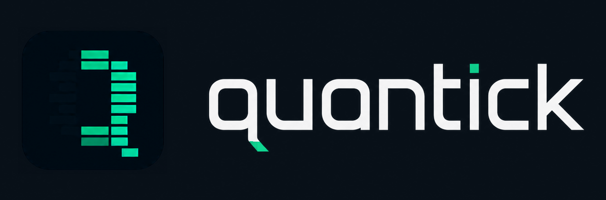
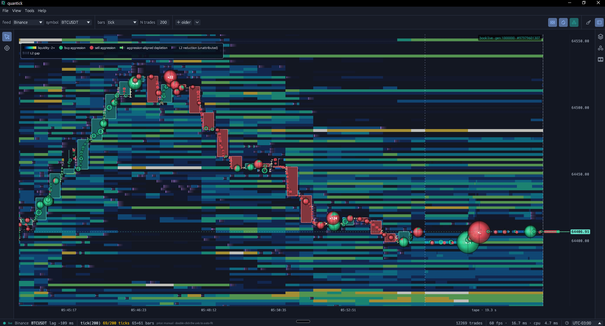

<p align="center">
  
</p>

# quantick

**Open-source trading platform for order flow.** Visualize the market by activity: tick, volume, dollar and imbalance bars over a live liquidity heatmap, footprint and aggression bubbles. Then paper-trade, backtest and script on the same engine.

<p align="center">
  
</p>

<p align="center"><em>Live BTCUSDT tick bars over the L2 liquidity heatmap, with buy/sell aggression bubbles and L2 reduction marks.</em></p>

> **Status:** in active development and used daily alongside live trading on crypto and Brazilian (B3) futures. Everything below runs today unless the [roadmap](#roadmap) marks it open. APIs still change. Orders go to a **paper account**: sending orders to a real broker is not built yet (see [Real-money orders](#real-money-orders)).

## Why this exists

Time-based candles distort order flow. A 1-minute bar at the session open and a 1-minute bar during lunch look identical on your chart, yet one may contain fifty times more trading than the other. Every indicator you compute on top inherits that distortion: a delta of +500 contracts means one thing in a quiet bar and something completely different in a busy one.

The fix has been known for decades: sample by **activity** instead of time. Close a bar every N trades, every N contracts, every $N of notional, or whenever buying or selling pressure gets unusually one-sided. The research literature, from Ané & Geman (2000) to López de Prado's *Advances in Financial Machine Learning*, documents why this works: activity-sampled bars have better statistical properties, and they make flow metrics comparable from bar to bar.

Bookmap, ATAS, Sierra Chart, NinjaTrader and Quantower chart order flow well, but they are closed source, mostly paid, and their bar engines cannot be read or reused outside them.

quantick is the open alternative: **a free trading platform built around those charts, where the bars you read live are the bars you backtest and paper-trade, and the engine is yours to read and reuse.**

## Who it's for

- **Order-flow traders** who want professional bar types, heatmap and footprint without platform lock-in
- **Strategy and bot developers** who need the bars they backtest to be the bars they trade
- **Quant researchers** who want reproducible activity-sampled bars for research and ML features
- **Agent builders** who want a real desktop application to drive over MCP, with a consent model instead of screen scraping

## What it does

### Read the market

- **Activity-sampled bars.** Tick, deal, volume, dollar and imbalance bars, Renko, and time bars from seconds to monthly. Switch the bar type and its parameter live.
- **Liquidity heatmap.** Resting L2 depth drawn behind the candles, with aggression bubbles, liquidity-response marks and honest gaps where the book was not synchronized. Details: [docs/liquidity-map.md](docs/liquidity-map.md).
- **Footprint and flow pane.** Per-price bid/ask volume inside each bar, and a flow pane beside the chart that shows candles or the tape.
- **Indicators and scripting.** A built-in indicator library (EMA, VWAP, CVD, delta histogram, RSI, MACD, Bollinger and more) written in *Quantick Pine*, a Pine v5 subset with order-flow builtins (`delta`, `cvd`, `buy_volume`, …) and hot reload. Write your own: [docs/pine-dialect.md](docs/pine-dialect.md).
- **Drawing tools.** Trend lines, rays, channels, Fibonacci retracement and extension, shapes, measure, text, price and date ranges, anchored VWAP, fixed-range volume profile and more.
- **History and replay.** Page back through venue history where the source provides it, or replay a recorded session print by print at up to 50×. Details: [docs/market-replay.md](docs/market-replay.md).

### Trade it

- **Paper trading from the chart.** An order ticket with risk-based sizing, brackets and exit ladders, filled against the live tape by a simulated fill model. Simulated fills differ from real executions.
- **Journal and reports.** Every paper trade is journaled; a report reads it back by session and by calendar.
- **Strategies and backtests.** A headless backtest runner replays a recorded session through the exact bar and indicator path the chart draws, and runs a strategy against the same `sim` order and fill core the paper account is built on.

### Work your way

- **Workspaces.** Tabs, split layouts, several windows, saved layouts and autosave.
- **Light and dark themes**, with candle appearance you can tune: [docs/candle-appearance.md](docs/candle-appearance.md).
- **An AI agent beside you.** A local MCP server lets Claude Code, Codex or any MCP client read the chart, wait for the bar you mark and answer on it, at a permission level you grant. See [Drive it with an agent](#drive-it-with-an-agent-mcp).

### Markets

| Source | Trades | L2 depth | Account needed |
| --- | --- | --- | --- |
| Binance spot and USD-M perpetuals | ✅ | Spot only | No, public data |
| Hyperliquid perpetuals (`BTC`, `ETH`, `HYPE`, `SOL`, `ZEC`) | ✅ | ✅ up to 20 levels | No, public data |
| MetaTrader 5 (for example B3 mini index and mini dollar) | ✅ | ✅ DOM | A broker account and a MetaTrader 5 terminal (Windows) running the bridge EA |

Feeds and symbols are configuration, not code: [`crates/app/config/feeds.toml`](crates/app/config/feeds.toml). Hyperliquid serves only a short recent-trades window, so history paging is disabled there.

## Real-money orders

quantick does not send orders to a real broker today. Every order fills against a paper account.

When live order routing arrives, a real-broker venue will be **off by default** and enabled only in your configuration. That is the trader's own opt-in. Separately, agents can never place orders unless you grant them the `trader` profile, which is denied by default and which the MCP adapter never asks for.

Nothing here is financial advice. quantick is MIT-licensed and provided as is, without warranty.

## Scope

quantick is a **desktop, local** trading platform. It runs on your machine, talks to venues directly and keeps your data in local files. It will not have a web app, a mobile app, a cloud account or cloud sync.

## Quick start: build, test, run

You need no exchange account, API key or credentials. Out of the box the chart connects to Binance's **public** market data and opens on `BTCUSDT`.

### 1. Install Rust

quantick is pure Rust. Install [rustup](https://rustup.rs/). The repository pins its toolchain in `rust-toolchain.toml`, and rustup installs that version, with the components it needs, the first time you run a cargo command in the clone:

```sh
# macOS / Linux
curl --proto '=https' --tlsv1.2 -sSf https://sh.rustup.rs | sh
# Windows: download and run rustup-init.exe from https://rustup.rs
```

There are no prebuilt binaries yet, so you build from source.

### 2. Clone and build

```sh
git clone https://github.com/milocaetano/quantick.git
cd quantick
cargo build --release -p quantick-app
```

The first build compiles every dependency and takes a few minutes; later builds are incremental. Contributors also run `cargo test --workspace`.

### 3. Run it

```sh
cargo run --release -p quantick-app
```

A native window opens, recovers the recent trades the source provides and then streams live trades, forming bars as they happen. The liquidity heatmap and the aggression bubbles are off by default: turn them on from the chart toolbar.

> quantick is a native desktop app (egui) and needs a graphical display. CI builds and tests it on Linux and Windows; it is used daily on Windows. macOS is not built or tested by CI.

### 4. (Optional) Pick a different feed or symbol

For a one-off startup selection, set `QUANTICK_DEFAULT_FEED` and `QUANTICK_DEFAULT_SYMBOL`. For example, to open on Hyperliquid BTC:

```sh
QUANTICK_DEFAULT_FEED=hyperliquid \
QUANTICK_DEFAULT_SYMBOL=BTC \
cargo run --release -p quantick-app
```

For a custom catalog, point `QUANTICK_CONFIG` at a TOML file or place a git-ignored `quantick.toml` in the working directory. Either replaces the built-in catalog rather than merging with it, so start from a copy of [`crates/app/config/feeds.toml`](crates/app/config/feeds.toml). The same file documents the MetaTrader 5 bridge, L2 options and logging; the L2 and logging environment variables are in [docs/liquidity-map.md](docs/liquidity-map.md).

## Drive it with an agent (MCP)

quantick ships its own **MCP server**. The chart is not only something you watch: an AI agent can read it and, when you allow it, answer on it.

The rule behind this is that a capability never ships reachable by mouse alone. Every action gets a named call, a readable result and a registry entry, so the agent and the trader operate the same application through the same contract.

### Connect one in three steps

```sh
cargo build --release -p quantick-mcp
target/release/quantick-mcp setup --client claude   # or: --client codex
```

1. **Register.** `setup` prints the exact registration command for your client, filled in with the binary's absolute path. Run the command it prints.
2. **Allow.** In quantick, open **Tools → Local agent access**, enable it, and tick the scopes the connection gets.
3. **Connect.** In the client, call `quantick_describe`.

The adapter attaches to a window you already opened. It never launches the application, never writes a client configuration file and never stores a token. Close the window, or turn access off, and every connection is revoked.

### What an agent can do

| Tool | What it answers |
| --- | --- |
| `quantick_describe` | The live instances; then version, profile, scopes, modules, capabilities and limits for one of them |
| `quantick_get_snapshot` | One coherent capture of the requested scopes, taken in a single pass |
| `quantick_get_chart_window` | A paginated page of closed bars: OHLC, volume, delta, trade count, as exact decimal strings |
| `quantick_get_scene` | Every control on screen, each with a stable ID, its owner, and a coded reason when it cannot be operated |
| `quantick_get_diagnostics` | Frame timing, feed arrival, engine state, queue metrics |
| `quantick_read_events` | A page of the event journal: tab, focus, feed, replay and market changes, and the bars you marked |
| `quantick_wait_for_change` | Parks up to 30 s until the journal moves, instead of polling |
| `quantick_capture_evidence` | A hashed, redacted investigation bundle, optionally with a screenshot |
| `quantick_search_capabilities` | Capabilities and scopes by substring or module, with availability |
| `quantick_invoke` | The long tail, under the same authority checks as the named tools |

Grant the **annotator** profile and the agent can also annotate the chart, notify you and attach scripts. The **cockpit** profile adds the canvas layout (panes, tabs, presets, focus) and reconnecting the feed.

**The loop this is built for:** press the mark hotkey over a bar. An agent parked in `wait_for_change` returns with that mark, reads the bars around it, and answers about *that* bar, pinned next to it if you granted annotation. It does not screenshot your screen and guess.

### What keeps it safe

- **Local only.** An authenticated loopback socket, discovered through a private per-user descriptor. Nothing listens on the network.
- **You choose the ceiling.** A ladder of profiles, each containing the one below: `observer` reads, `analyst` adds private reads, `annotator` also answers on the chart, `cockpit` also rearranges the canvas. The top profile, `trader`, covers order placement; it is denied by default and the MCP adapter never asks for it.
- **Refused at the gate.** A capability you did not grant fails with `control.permission_denied`, whichever tool asked for it.
- **Attributed.** Anything an agent draws is marked as the agent's, and it can never remove something you drew by hand.
- **Written down.** The [capability catalog](schemas/control/observer-capability-catalog-v1.json) and wire schemas are generated from the Rust contracts and checked by a snapshot test. The trust boundary has a [threat model](docs/control-plane/observer-threat-model.md).

Full reference: [`crates/mcp/README.md`](crates/mcp/README.md) and [`docs/control-plane/`](docs/control-plane/).

## Design principles

1. **One engine, three consumers.** Chart, backtest and bot share the bar aggregator; paper trading and backtests share the `sim` order and fill core. Divergence between them is designed out, not tested out.
2. **Deterministic.** Same trades in, same bars out. Always.
3. **Data honesty.** Inferred or incomplete data is labelled, never silently patched: a depth reduction is an "unattributed L2 reduction", never a cancellation.
4. **Desktop and local.** No web app, mobile app or cloud. A real-broker venue stays off until enabled in configuration.
5. **Operable without a hand.** Every capability has a named call, a readable result and a registry entry. That is what makes the MCP control plane possible.

## Architecture

A Cargo workspace of one-way-dependent crates. The domain below the app is headless (no UI, network, async or wall clock), and the build fails on a reverse dependency or a module cycle. The main crates by area are below; [AGENTS.md](AGENTS.md) maps every crate.

| Area | Crates |
| --- | --- |
| Bar engine | `engine` |
| Order book and order flow | `orderbook`, `orderflow` |
| Indicators and scripting | `indicators`, `indicator-session`, `pine` |
| Chart, drawings and layout | `chart`, `chart-interaction`, `drawings`, `layers`, `workspace`, `appearance` |
| Trading, paper and backtest | `trading`, `sim`, `paper`, `strategy`, `backtest` |
| Feeds and replay | `feed`, `feed-binance`, `feed-hyperliquid`, `feed-mt5`, `replay`, `sources` |
| Agent control plane | `control`, `control-schema`, `control-host`, `control-handlers`, `control-local`, `mcp` |
| Desktop app | `app`, `platform` |
| Shared support | `session`, `stores`, `civil`, `backpressure`, `operability`, `anchored-studies`, `guards` |

## Roadmap

- [x] Activity-sampled bar engine (tick, deal, volume, dollar, imbalance, Renko, time)
- [x] Binance, Hyperliquid and MetaTrader 5 feeds
- [x] L2 liquidity heatmap, aggression bubbles, footprint
- [x] Quantick Pine scripting and a built-in indicator library
- [x] Drawing tools, anchored VWAP and fixed-range volume profile
- [x] Market replay of recorded sessions (trades only)
- [x] Paper trading with journal and reports
- [x] Backtest runner on the same engine and order core
- [x] Agent control plane and MCP server
- [x] Workspaces, multiple windows, light and dark themes
- [ ] Depth replay, so the heatmap works in market replay
- [ ] Live order routing to brokers, off by default, behind an explicit opt-in
- [ ] Python bindings and a C API for the engine

## Built with AI agents

Most of this repository is written by AI agents (Claude Code and Codex) working for one human maintainer, who decides what gets built, uses every build and is the only one who merges to `main`. More than 550 pull requests have merged this way since July 2026.

- **Rules the build enforces.** [`crates/guards`](crates/guards) fails the build on a reverse crate dependency, a module cycle, UI or wall-clock code below the app, or a file over 1,500 lines.
- **Determinism proven by tests.** Engine work is test-first: fixture trades and expected bars come before the code.
- **Workflows are versioned skills** under [`.claude/skills/`](.claude/skills/), shared with Codex through [`.agents/skills/`](.agents/skills/).
- **The author never grades its own work.** A separate agent reviews each diff, and the maintainer proves user-facing changes by using the build.

[docs/agentic-development.md](docs/agentic-development.md) tells the full story.

## Documentation

[docs/README.md](docs/README.md) indexes the documentation: the control-plane contract, the Pine dialect, the liquidity map, market replay and the design records. [AGENTS.md](AGENTS.md) is the entry point for an AI agent.

## Contributing

Ideas, use cases and design discussion are welcome: [start a discussion](https://github.com/milocaetano/quantick/discussions). For code, every change passes `cargo fmt --all -- --check`, `cargo clippy --workspace --all-targets`, `cargo build --workspace` and `cargo test --workspace`; see [CONTRIBUTING.md](CONTRIBUTING.md).

## License

MIT, provided as is, without warranty.

Bookmap, ATAS, Sierra Chart, NinjaTrader, Quantower and MetaTrader are trademarks of their owners; quantick is not affiliated with them.
