# Light theme: menu and settings audit

**Status: illustrated recommendations and semantic menu/settings inventory delivered.** This is a visual audit, not a UI implementation or an execution certification. The coverage companion distinguishes inspected configuration forms from unexecuted operational states.

The original runtime baseline is `ee7ea6b54ffc035daf46ac6e02055090c69b5729` on `milocaetano/quantick:feat/quantick-new-layout`. The resumed audit also inspects feature tip `f32407a05c10e6a8d41a38ecfbf9a999cb530359`, whose title strip, Home, tabs and toolbar appearance changed upstream. Original images retain their original baseline identity; current-tip observations are identified separately below. Captures use isolated stores and the bundled Light appearance. Light deliberately combines warm off-white interface surfaces with a dark Bookmap plot. The user's existing instances and saved workspace are preserved.

Two independent AI design reviewers and two independent AI UX reviewers assessed the evidence. These are expert-role AI evaluations, not human interviews or usability tests. Their shared direction is to strengthen specific active text, enlarge consequential explanations, and fix confirmed overlaps while preserving disabled-state hierarchy.

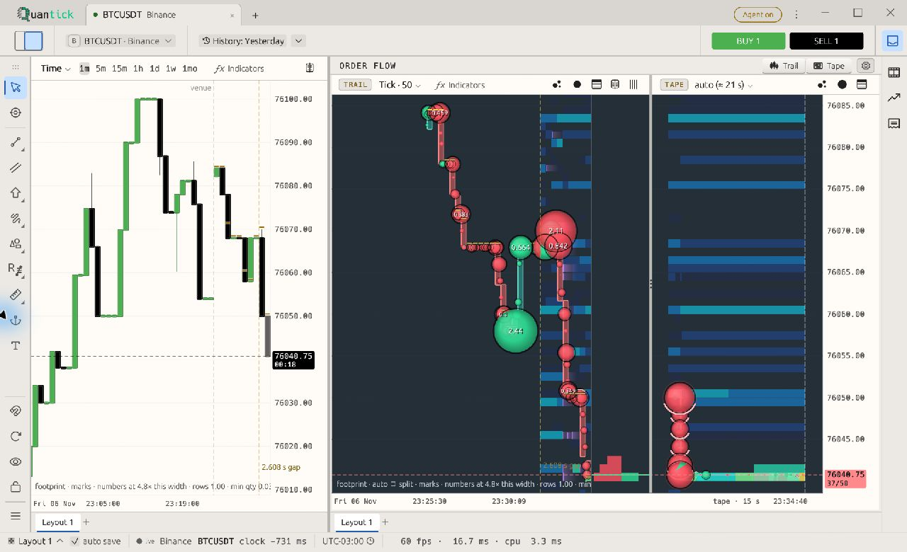

## Findings and recommended changes

**Should-fix** means a visible reading or layout problem worth addressing before polish. **Consider** means a smaller hierarchy improvement. No trading-correctness or safety blocker is claimed from these screenshots. Coordinates below are `(left, top)–(right, bottom)` in the full image, from its top-left corner; most images are 1280×780, the two agent-permissions images are 1440×900, and images explicitly labelled narrow are 1000×740. Open an image at native size to inspect small text.

### F01 · BUY text has weak contrast — Should-fix

**Where:** main toolbar and Paper trading. In the ticket image, `(916,318)–(1072,352)`; the toolbar repeats it at `(1004,46)–(1109,70)`.

White `BUY 1` is visibly weaker on green than white `SELL 1` on black. Source tokens are `chip_ink #FFFFFF` and `buy #4CAF50`, giving **2.78:1**. The active ticket uses these directly in `paper_trading/ticket/entry_pair.rs`; this is not disabled fading.

**Change:** resolve the foreground separately for each trade action. `#202020` on the same green gives **5.86:1**; alternatively use a darker action-only green with white text. Preserve the chart's candle colour and white SELL label. A global `chip_ink` change would damage other buttons.

**Check after implementation:** toolbar and ticket, both sides, normal/hover/focus/armed/disabled states.

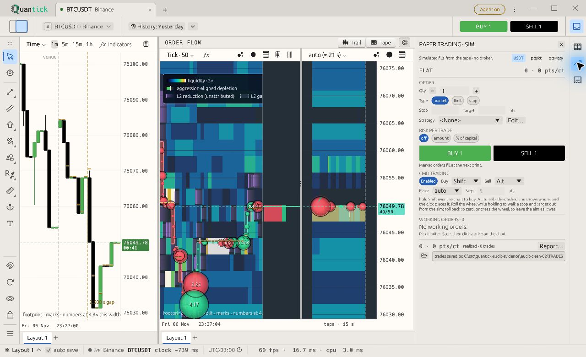

### F02 · Active shortcuts look disabled — Should-fix

**Where:** window menu, chart arrangements and Help → Keyboard shortcuts. Help image `(148,92)–(233,316)`; menu image `(1054,70)–(1131,286)`.

The shortcut column is pale even in the help window whose purpose is to teach those keys. `settings_window.rs` uses `ui.weak`; egui's button shortcuts use the same weak-text path. With Light's foreground `#505050` and weak backing `#F7F4F0`, egui 0.29.1 derives opaque **#A3A2A0**, only **2.11:1** against `chrome #ECE9E4`.

**Change:** use readable supporting text for enabled shortcuts, retaining the two-column alignment. `text_support #555555` gives **6.16:1** on this chrome. Keep genuinely unavailable actions visually distinct.

The same weak path marks inherited bubble colours as `(theme)` at `(978,550)–(1136,649)` in the [colour settings capture](images/bubble-colour-inheritance.jpg). That state remains meaningful while the colour swatch is editable; apply the same supporting-ink treatment.

**Check:** dedicated help, unselected/selected menu rows, layout shortcuts and inherited-colour labels.

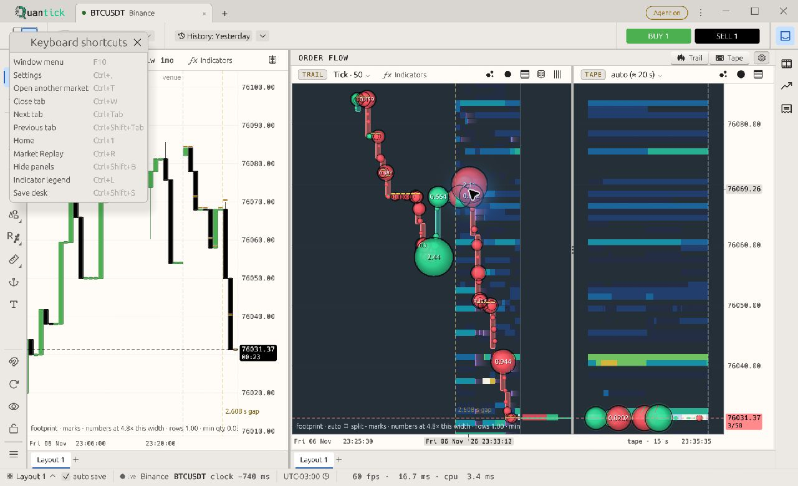

### F03 · Permission explanations are fine print — Should-fix

**Where:** Settings → Agent access → Manage clients. First image `(8,590)–(519,620)` and `(8,754)–(519,786)`; [scrolled endpoint](images/agent-permissions-end.jpg), `(8,276)–(522,306)` and `(8,505)–(522,531)`.

The paragraphs explaining reading, annotation and rearrangement rights are substantially smaller than normal labels. All four reviewers agree that consequential explanations should be easier to read. `control/gateway/panel.rs` uses `ui.small` for these paragraphs.

**Change:** use supporting body size and line spacing, with short paragraphs. Keep technical IDs secondary. Preserve the lock on changing scopes while access is enabled; present current grants as readable read-only information rather than relying on faded checkbox labels. Put the reason for the lock near the first scope heading, retaining the bottom instruction.

**Check:** access On and Off, the full scroll range, and long permission descriptions. Disabled editing must not be mistaken for permission to change a live grant.

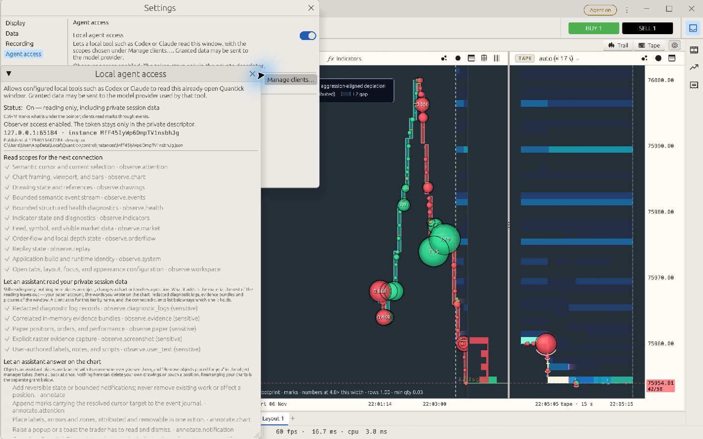

### F04 · Configuration consequences and units are undersized — Should-fix

**Where:** chart-settings persistence notices, exit strategies, paper-ticket instructions and empty-report guidance.

| Example | Region | Required improvement |
| --- | --- | --- |
| [Candles persistence](images/candles-persistence.jpg) | `(5,762)–(390,776)` | Make scope/persistence notices readable secondary body text, with room to wrap |
| [Exit strategy](images/exit-strategy.jpg) | `(535,205)–(720,224)` and `(535,261)–(714,276)` | Enlarge Qty %, Gain, Loss and readiness; use `Gain (ticks)` and `Loss (ticks)` over their own fields |
| [Paper ticket](images/paper-ticket.jpg) | `(914,352)–(1174,367)` and `(914,428)–(1229,465)` | Enlarge the fill rule and command-trading steps; keep them next to the action |
| [Empty report](images/paper-report-empty.jpg) | `(64,225)–(572,271)` | Enlarge next-step and simulated-value explanations; retain the clear empty-state headline |

These examples share a typography problem, not a proven colour failure in every sentence. The strategy headings and ticket explanations explicitly use `.small()`; the appearance Small reference role is 9 logical pixels. The report has ample space for useful guidance at a readable size.

**Change:** promote information needed to understand a value or consequence to supporting body size. Keep incidental debug metadata small. Use a shared column grid for strategy headings and fields rather than adding manual spacing as labels grow.

The narrow 1000×740 ticket also exposes tiny supporting risk text. In [Limit / amount risk](images/narrow-risk-amount.jpg), `(641,392)–(947,425)` explains point value and size step; in [Stop / percent-of-capital risk](images/narrow-risk-capital.jpg), `(642,349)–(938,363)` explains declared capital and `(641,407)–(947,439)` explains instrument sizing. These instructions should remain readable next to the editable values. No clipping, incorrect calculation or order-placement behavior is established by these screenshots.

**Check:** bottom scroll positions, wrapped instructions and every strategy column at normal and narrow sizes. `PAPER TRADING · SIM`, `TRADES · SIM` and `Simulated performance` are already visible; this finding does not claim simulation is unlabelled.

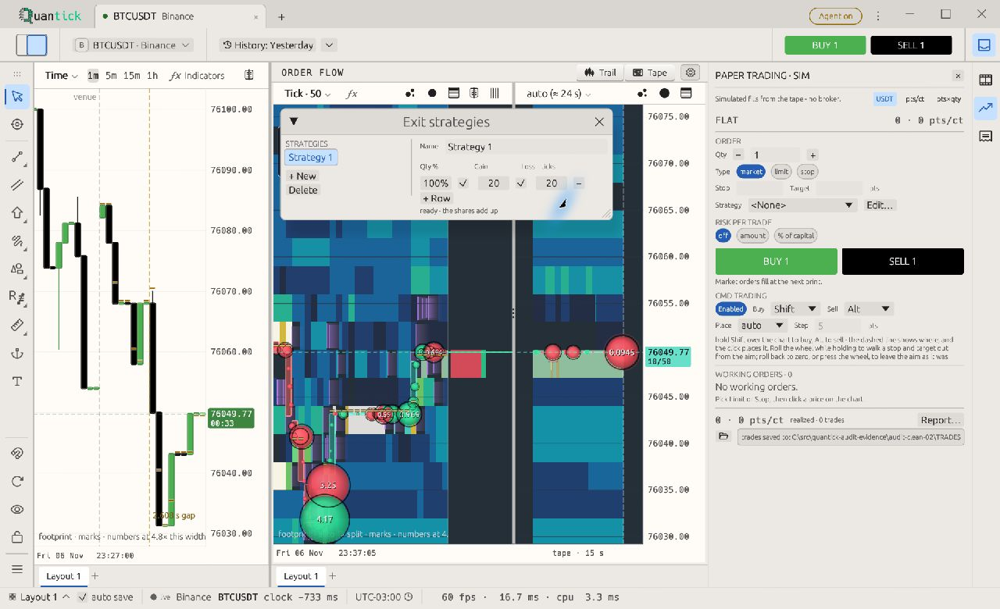

### F05 · Replay preparation guidance is too small and dense — Should-fix

**Where:** Help → Replay file format, `(359,391)–(918,641)`; [Market Replay → Get data](images/replay-get-data.jpg), `(359,428)–(905,554)`.

Required columns, timestamps, file examples and download limitations are much smaller than the surrounding controls. These instructions determine how a user prepares usable data; they are not incidental metadata.

**Change:** use readable supporting text, separate folder layout, example CSV and column rules, and give the example a selectable monospace block. Keep the prerequisite for lookup and the candle-versus-order-flow distinction near their controls. Allow scrolling instead of compressing the explanation.

**Check:** expanded file-format section, Get data prerequisites and long paths. Disabled Play/Download actions are separate states and are not the finding.

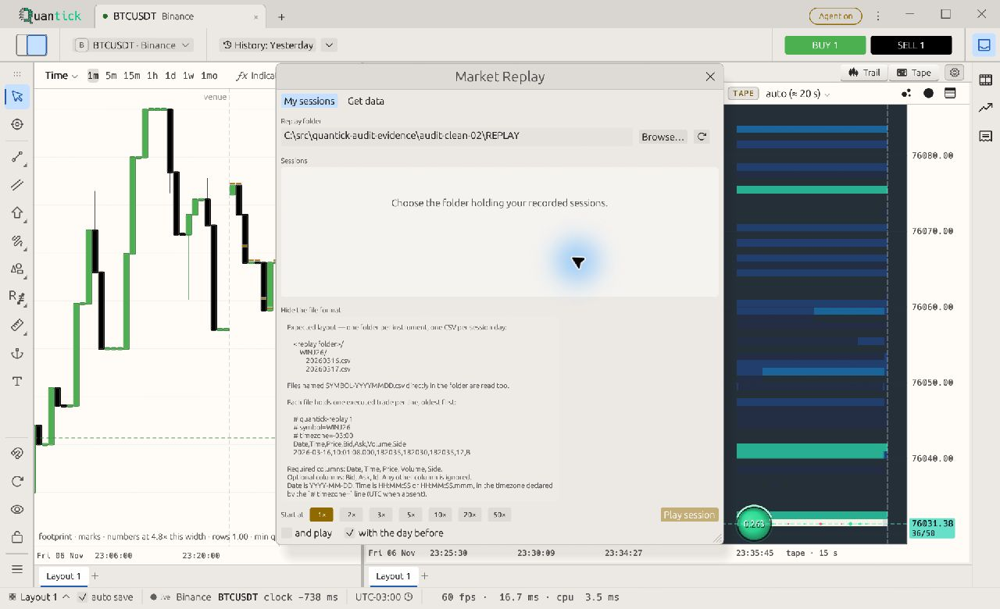

### F06 · Editable preset-name fields resemble disabled controls — Should-fix

**Where:** Candles presets `(5,478)–(252,502)` and [Footprint presets](images/footprint-preset.jpg), `(5,452)–(249,477)`.

The empty name field has a very subtle backing and a pale hint beside a pale Save action. The available first step looks like part of an inactive row. Save may legitimately be disabled until a name is entered; the input should still advertise that it is editable.

**Change:** give the editable field a visible boundary and readable placeholder or persistent label. Preserve Save's disabled state and existing preset semantics.

**Check:** empty, focused, typed, saved and duplicate-name states. Do not treat this as a request to darken every disabled control. This is a design recommendation with fewer independent confirmations than F01–F04; validate its interaction benefit during implementation.

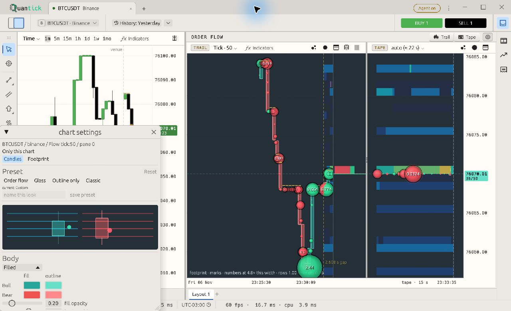

### F07 · Active navigation carets are unnecessarily faint — Consider

**Where:** window-menu arrows `(1114,159)–(1126,224)` and `(1114,299)–(1126,311)`; the bars caret near `(584,113)–(597,127)` in the baseline.

The arrows are much weaker than their active labels. Their placement is regular: this is an ink hierarchy recommendation, not a confirmed icon-alignment defect. The bars-control source further dims `text_faint` with `gamma_multiply(0.6)`.

**Change:** use an undimmed semantic supporting/icon colour for active carets. Preserve visual hierarchy through size and spacing. Do not apply this judgement to every flyout: the second designer found the Lines and Fibonacci columns coherent and readable.

**Check:** active versus disabled submenu rows, selected backgrounds, and Dark/Light parity.

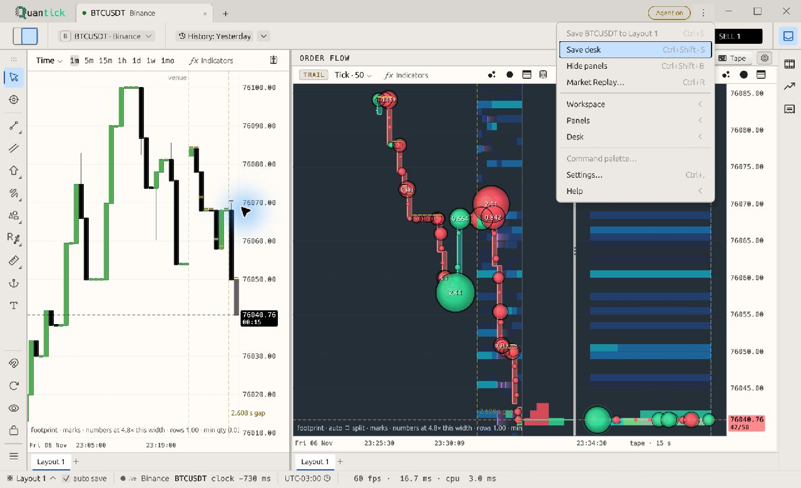

### F08 · Market-search footer labels overlap — Should-fix

**Where:** Open a market, unknown query `no-market-match`; `(717,399)–(960,416)`.

The `Ctrl [Return] background` hint and `Add no-market-match and open` action paint over one another. The collision repeats in a second stable capture at 1280×780 and in the [1000×740 narrow capture](images/narrow-market-overlap.jpg), `(577,399)–(824,416)`. `surfaces/market_palette.rs::draw_footer` puts Bars, size, Workspace, the hint and a variable-length action on one row without reserving enough width.

**Change:** move action and keyboard hints onto a second row when measured space is insufficient, or reserve a bounded action column and shorten the visible action to `Add and open`. Keep the market/query explicit in the result and accessible label.

**Check:** empty/unknown query, long symbols, long workspace names and commands mode. This is a confirmed text collision, unlike the rejected general Settings-width hypothesis.

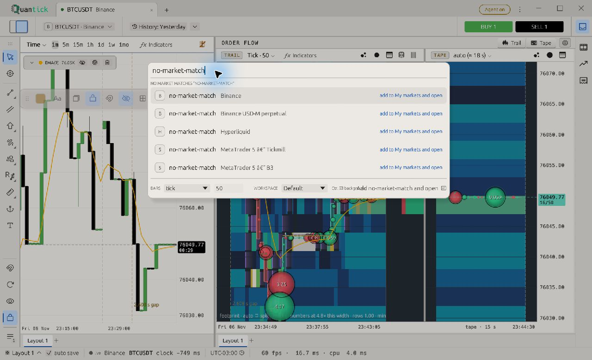

### F09 · Drawing toolbar covers object-manager actions — Should-fix

**Where:** Drawn objects with a selected text drawing; `(52,193)–(388,220)`.

The floating drawing toolbar occupies the same space as `Show all`, `Unlock all` and `Delete all...` in the manager footer. The supplied sequence repeats the visual conflict with locked and hidden states. The evidence proves visual occlusion; it does not establish which control receives a click.

**Change:** include the manager rectangle in context-bar placement exclusions, or suppress the redundant floating toolbar while the manager is open and retain operations in the manager/inspector.

**Check:** manager open/closed, unlocked/locked/hidden drawing and a manually parked toolbar. Preserve the return path after closing the manager.

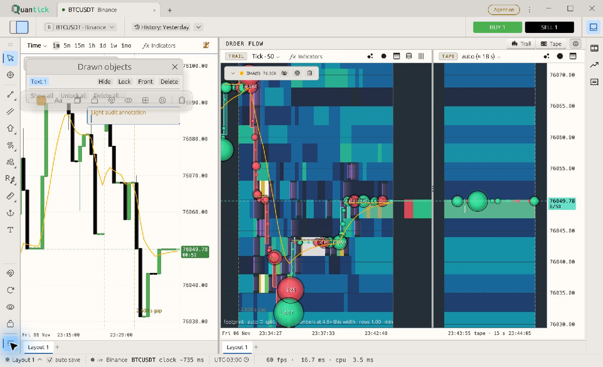

### F10 · Small amber annotation text is weak — Should-fix

**Where:** text drawing shown with properties/coordinates open; `(80,236)–(205,245)`.

`Light audit annotation` is visibly less legible than nearby dark interface labels. The nominal opaque pair `drawing_default #B5832B` on Light `canvas #FFFCF7` is **3.29:1**. The selected editor's backing and antialiased edges can differ; this is a source-token comparison, not a measured ratio for every displayed pixel.

**Change:** give text annotations a darker semantic ink in Light, or an explicitly contrasting text/backing pair. Preserve amber drawing strokes where useful rather than changing every drawing globally.

**Check:** ordinary text outside its editing box, selected/locked/hidden states and both Time/Bookmap backings before finalizing the implementation scope.

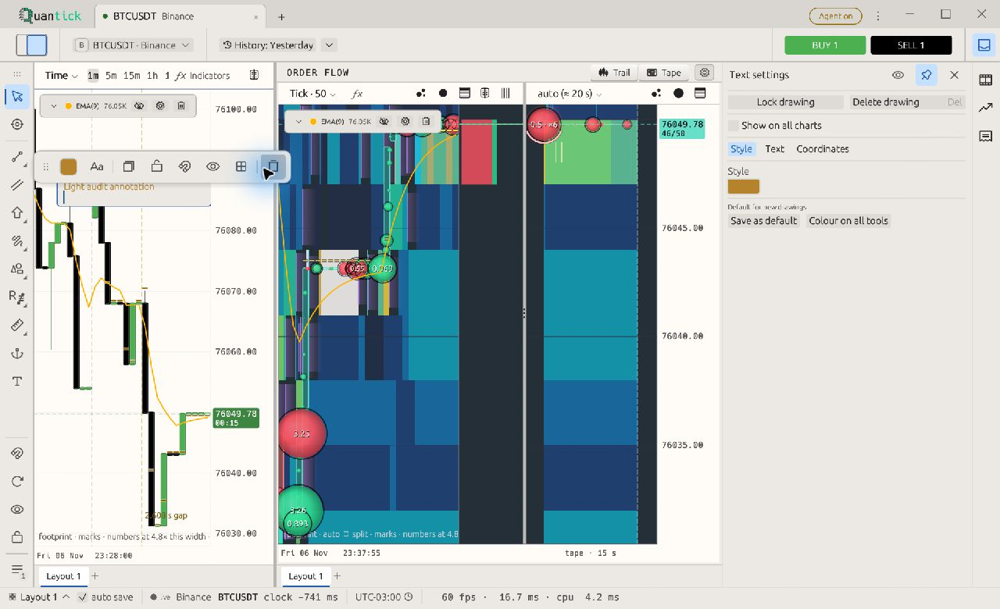

### F11 · Top-docked drawing toolbar leaves a black gutter — Should-fix

**Where:** Panels → Drawing toolbar → Top at 1000×740; `(0,125)–(999,156)`.

A full-width black strip separates the Light drawing toolbar from the chart headers. It remains in two settled captures; the matching Bottom arrangement has no such strip. This documents an unexplained rendered gutter, not a trading or input failure. The top and bottom rail paths in `toolrail.rs` both use `rail_frame`, whose fill is the Light chrome token, so the observed black band is not explained by the rail's intended fill.

**Change:** investigate the height reservation and background painting between the top rail and the chart container. Remove the unused band or fill an intentionally reserved region with its semantic surface colour. Do not change Bookmap's intended dark plot to conceal this separate chrome issue.

**Check:** switch Left → Top → Bottom → Top, narrow and normal widths, and a fresh launch with the Top position restored. Confirm header positions and drawing-control reachability remain correct.

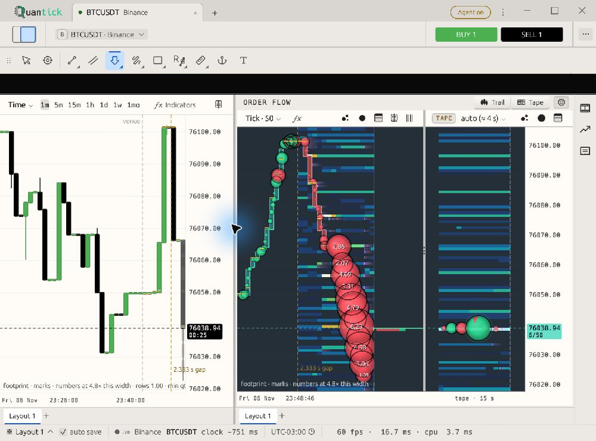

## Review agreement and remaining differences

D1: design/contrast; D2: design/typography and component layout; U1: UX/discoverability and state clarity; U2: UX/accessibility and glance readability. **Agree** means the reviewer supported the relevant observation; **—** means no explicit verdict for that finding, not approval or rejection. Partial agreement is retained instead of manufacturing a unanimous vote.

| Finding | D1 | D2 | U1 | U2 | Reconciled recommendation |
| --- | --- | --- | --- | --- | --- |
| F01 BUY contrast | Agree | Agree | — | Agree | Separate action foregrounds; preserve SELL and chart colours |
| F02 active shortcuts | Agree | — | Agree | Agree | Readable support ink; keep disabled actions distinct |
| F03 permission prose | Agree | Agree | Agree | Agree | Enlarge consequential text; preserve lock semantics |
| F04 consequence/unit microcopy | Agree | Narrow risk subset | Settings subset | Agree | Selective supporting-body typography, not global enlargement |
| F05 replay guidance | Agree | — | — | Agree | Readable structured instructions |
| F06 preset input affordance | Agree | — | — | — | Validate editable-field treatment, keep disabled Save |
| F07 navigation carets | Agree | Other flyouts readable | Agree | — | Local polish; no blanket icon realignment |
| F08 market-footer collision | Agree | Agree | Agree | — | Reserve width or wrap footer |
| F09 drawing-manager overlap | Agree | Agree | Agree | — | Prevent visual overlap; click routing not established |
| F10 amber text | Agree | Agree | Agree | — | Text-specific contrast treatment; validate outside editor |
| F11 top-toolbar gutter | — | Agree | — | — | Investigate reserved space and surface painting; no functional claim |

The reviewers also agreed that primary Settings labels, switches and the inspected timezone options are coherent. No convincing general icon-baseline error was established. The permission-scope discussion has a nuance: disabled editing is intentional, while names and consequences remain useful to read. The recommendation preserves both facts.

## Additional UX suggestions

| Suggestion | Evidence | Disposition |
| --- | --- | --- |
| Explain why the only layout cannot be deleted | [Layouts menu](images/layouts-menu.jpg), `(398,428)–(638,453)` | Add a visible or hover/focus explanation such as “Keep at least one layout”; do not enable the invalid action |
| Distinguish saved drawing layouts from chart arrangement | Same menu and its adjacent Layout submenu | Consider scope-bearing labels such as “Drawing layouts” and “Chart arrangement” |
| Expose the selected theme in the closed control | Settings Display, reviewed in 01/10/20 | Consider `Theme: Light`; the opened chooser already identifies Light |

## Capture methodology

### Current feature-tip follow-up

After the audit resumed, the documentation branch was rebased onto feature tip `f32407a05c10e6a8d41a38ecfbf9a999cb530359`. A fresh harness build completed successfully from the rebased worktree. This upstream change redesigned the title strip, Home, tabs and toolbar backing; it also removed the inherited app-size guard failure. No runtime fix was authored by this audit.

The follow-up inspected the distinct configuration forms missing from the original 32 broad route groups: all seven drawing-owned inspector tabs (including the previously inspected Text tab), stroke/fill and three-anchor/locked coordinates, floating inspector scrolling, context colour/width/text-size popovers, native CVD, every shipped script's actual Inputs/Style surface, Arm strategy and conditional alarms, the full grouped sound list, quick-range ready/future controls, commands mode, chart Objects and clear confirmations, drawing preset save/overwrite states, a layout deletion question, Bubbles colour picker, populated recent exports and successful import feedback. See the [finite form inventory and state exclusions](coverage.md#resumed-semantic-form-inventory).

The independent follow-up designer and UX reviewer both found the long Copilot and Exhaustion reversal forms complete and aligned at 1280 logical pixels. ZigZag, Range box and Force bar expose object-only input forms with no Style tab; repeated `:style` launch requests are **N/A**, not additional visited dialogs. The reviewers support the existing F01, F04 and F06 recommendations without adding a new alignment defect. In particular, the drawing preset name fields and locked-coordinate explanations repeat the existing affordance and typography problems; ordinary script input labels remain readable.

| Existing finding | Current-tip disposition |
| --- | --- |
| F01 BUY contrast | Still visible on the changed white toolbar backing; foreground and green fill tokens are unchanged |
| F02/F07 shortcuts and carets | Still visible in the actual current window menu; the slate title strip does not make its Light popup dark |
| F04 consequential microcopy | Confirmed also in the shared drawing-lock and coordinate-unlock explanations; no blanket criticism of script input labels |
| F06 editable preset names | Confirmed also in VWAP, profile and Fibonacci forms; typing enables Save, and a saved duplicate opens an explicit Overwrite? Yes/No row |
| F08 market footer | Stable text collision reproduced on current tip |
| F09 manager overlap | Reproduced with the populated manager and its delete-all question; Keep cancelled it, preserving all 22 demo objects |
| F11 top toolbar | Black band reproduced on current tip at 1280 logical width |
| F03/F05/F10 and original F04/F06 examples | Original-baseline evidence retained; their owning paths and relevant tokens are unchanged upstream. This is evidence reuse, not a claim that every old image was recaptured |

No original finding is claimed fixed by the title-strip update. These five full-window PNGs are **1920x1170 physical pixels at 1.5 pixels per logical point**, representing a 1280x780 logical window. Original image coordinates above still refer to the original images.

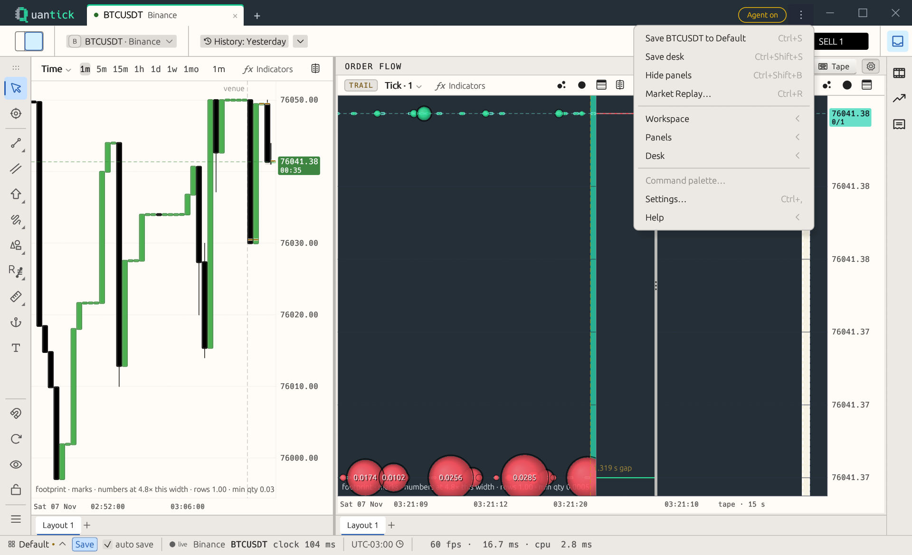

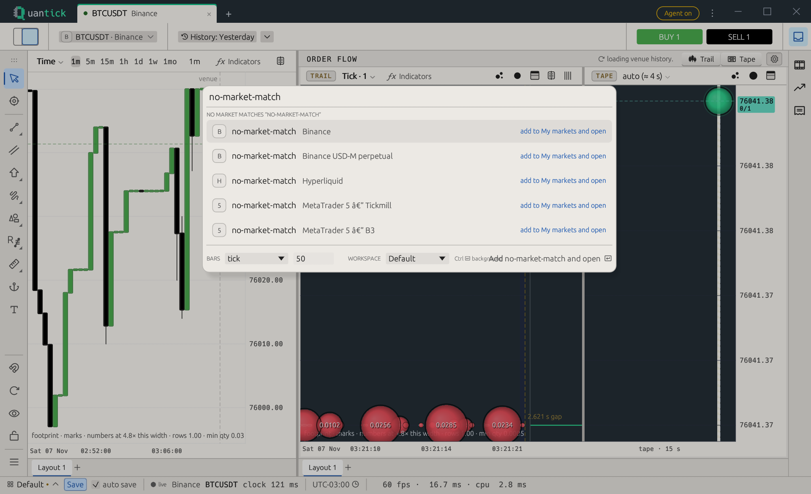

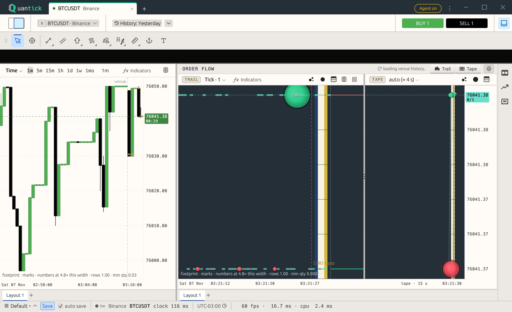

The [locked-coordinate capture](images/current-locked-coordinates.png) shows the additional F04 example, and the [profile preset capture](images/current-profile-presets.png) shows the additional F06 example. Follow-up scratch captures 194-236, including named script families under 202, remain outside Git. They use isolated stores. The gallery and strategy forms are staged harness fixtures; the replay is explicitly synthetic. The paper-demo capture showed an open simulated position, while its early performance window remained empty: neither is described as a populated closed-trade report.

One export dialog displayed a scratch filename set through accessibility but saved its original OS suggestion instead. Creation time and the unique audit preset proved ownership of that newly created file. After inspecting the populated recent-files menu and importing the same four audit settings groups, the file was moved to scratch evidence; no preexisting user file was replaced or moved. Native file-dialog behaviour is not presented as a Quantick Light finding.

### Original baseline

The audit build used the exact source baseline `ee7ea6b54ffc035daf46ac6e02055090c69b5729`. From the isolated audit worktree, the executed PowerShell build command was:

```powershell
$env:CARGO_TARGET_DIR = 'C:/src/quantick-audit-target'
cargo build -p quantick-guards -p quantick-app --features quantick-app/harness
```

The inspected executable was `C:/src/quantick-audit-target/debug/quantick-app.exe`. Launches selected the bundled Light file through `QUANTICK_THEME`, enabled local observation, and used separate cockpit stores, paper state, recordings, journals and script folders under `C:/src/quantick-audit-evidence`. The copied feed configuration changed the MetaTrader listener from port 9100 to 19100 to avoid the user's running listener. Live Binance BTCUSDT provided the chart context; market values therefore vary between screenshots.

The requested logical window sizes were 1440×900, 1280×780 and 1000×740. The image dimensions shown in this report match those respective captured sizes; these observations do not certify every DPI or display scale. Menu and setting changes were exercised in the isolated session. No runtime product source, colour token, layout implementation or user workspace was edited for this documentation change.

## Evidence limits and exclusions

- Captures 15–19 were from an interrupted Dark sequence and are excluded from this Light audit.
- Source inspection suggested possible Settings overflow, but the inspected Display/Data/Recording/Agent access states at 1440×900, 1280×780 and 1000×740 did not confirm it. In narrow captures 139–142, long Data descriptions still wrap without overlap and switches align with their titles. The Settings window fits inside the narrow viewport.
- Disabled Delete layout, empty-replay actions and locked permission editing are not active-control contrast failures. The reason for unavailability can still deserve clearer wording.
- A low-position candle colour picker reached the screen edge in capture 28. Reviewers differed on whether staged window position was enough to establish the cause. Keep this as a placement follow-up, not a settled default-placement defect.
- Dark Bookmap is intentional. Empty Session/Trades/Report states identify their emptiness and next action; blank space is not missing data.
- The original flat ticket and empty ledger/report do not validate populated P&L, orders or performance charts. The follow-up adds an open simulated position, not a populated closed-trade report. Still images do not prove keyboard behavior, persistence, latency, accessibility conformance or click routing.
- Original screenshots are unedited full-size JPEGs; current-tip attachments are full-size PNGs. The original 05/08 files had `.png` names but JPEG contents; the copies use the correct `.jpg` extension. Approximate coordinates and source-token contrast are distinguished from compressed pixels. Blue pointer halos are capture interaction indicators, not proposed UI changes.
- A MetaTrader-label encoding artifact in the isolated market configuration is excluded pending reproduction with an unmodified UTF-8 configuration.

## Coverage and delivery reconciliation

The [original 32-route ledger and resumed semantic form inventory](coverage.md) record observed menus, configuration forms and explicit state limits. The broad route count alone did not establish all-options coverage; the resumed inventory closes the distinct drawing, indicator and contextual forms it omitted. This does **not** mean every state passed, every numeric value was tried, or every workflow was executed. Synthetic fixtures, cancelled confirmations and empty/disabled states remain distinct from financial or persistence verification.

| Requirement | Delivery evidence | Status |
| --- | --- | --- |
| R1 Requested branch and Light | Baseline identity above and Light screenshots | Delivered audit evidence |
| R2 Navigate menus/settings | Original route ledger plus finite semantic form inventory, expanded/scrolled content and current-tip follow-up | Delivered visual options inventory; operational state limits remain explicit |
| R3 Prints for defects | Illustrated findings with screenshots and regions | Delivered; final link/artifact checks in R6 |
| R4 Two design and two UX opinions | Independent AI roles and agreement matrix | Delivered |
| R5 Illustrated document under docs | This report, semantic image files and coverage companion | Delivered |
| R6 Pull request | [PR #784](https://github.com/milocaetano/quantick/pull/784), documentation-only scope against feat/quantick-new-layout | Opened; current-head review and delivery receipts are retained on the PR |

No runtime source changes are included. Proposed fixes require their own implementation and before/after validation.
